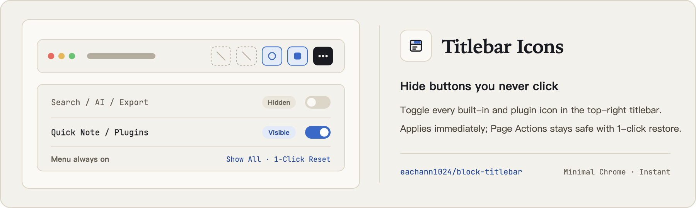

<picture>
  <source media="(prefers-color-scheme: dark)" srcset="assets/card-en-dark.png">
  <source media="(prefers-color-scheme: light)" srcset="assets/card-en-light.png">
  
</picture>

- **Per-button switches**: Hide built-in actions or icons added by other plugins.
- **Instant save**: Changes take effect immediately from the plugin settings page.
- **Safe restore**: Page Actions stays pinned, plus a one-click Show All button.

**Install**: Open Block Settings -> App Store and search **Titlebar Icons**, or enter `eachann1024/block-titlebar`.
