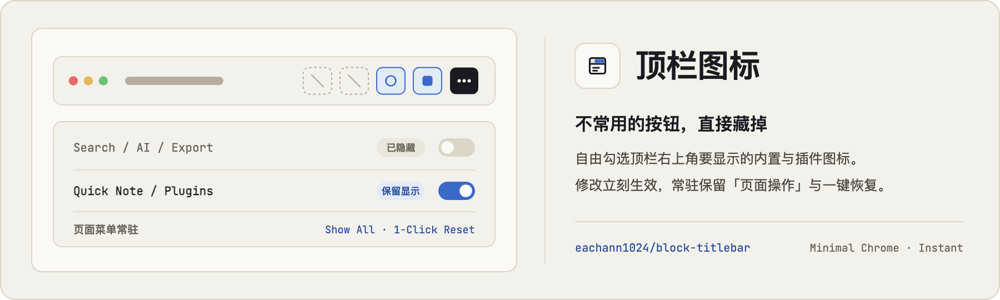

<picture>
  <source media="(prefers-color-scheme: dark)" srcset="assets/card-zh-dark.png">
  <source media="(prefers-color-scheme: light)" srcset="assets/card-zh-light.png">
  
</picture>

- **逐个自由显隐**：内置按钮与其他插件挂载的顶栏图标都能按需隐藏。
- **改完即刻生效**：在本插件设置页切换开关，自动保存。
- **防误藏保护**：「页面操作」入口始终保留，随时支持「全部显示」一键还原。

**安装**：打开 Block「设置 → 应用商店」搜索 **顶栏图标**，或手动填入 `eachann1024/block-titlebar`。
